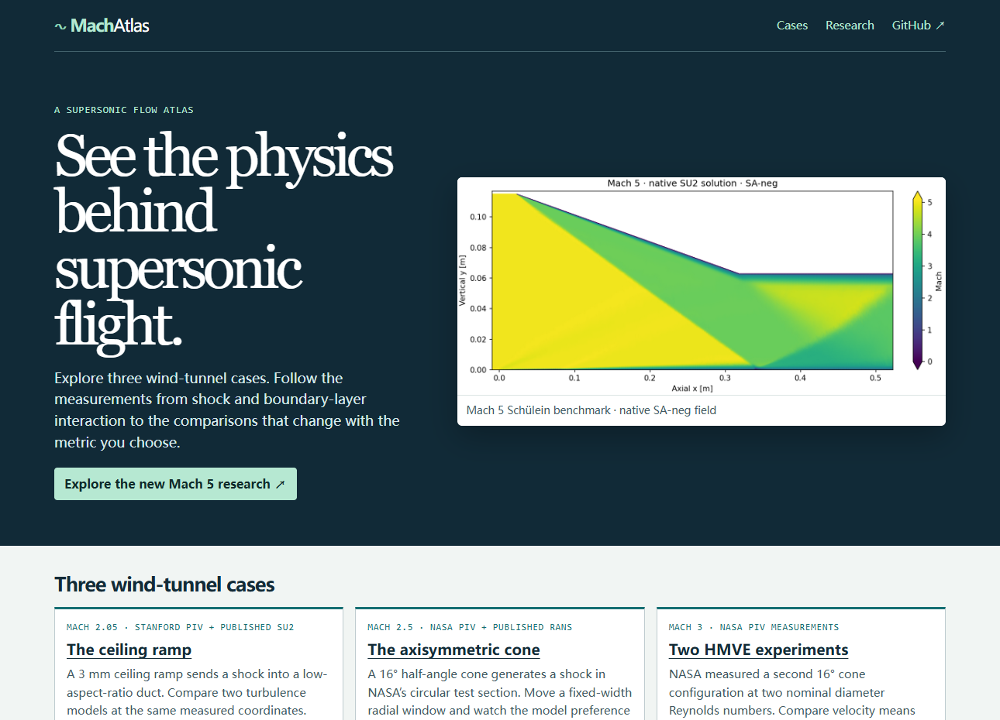

# MachAtlas

**See the physics behind supersonic flight.**

**New in v0.2.0.** [Native SU2 research](https://hengyuhang61-creator.github.io/machatlas/research.html), with new computed fields, three Mach 5 grid levels, the wall-temperature comparison and the Mach 2.05 transfer checks. [Methods and native replay](research/README.md).

An interactive atlas of three wind-tunnel shock–boundary-layer interaction cases. Explore measured velocity maps and change the comparison metric or radial sampling band.

[Open the atlas](https://hengyuhang61-creator.github.io/machatlas/) · [Release](https://github.com/hengyuhang61-creator/machatlas/releases/latest) · [Report an issue](https://github.com/hengyuhang61-creator/machatlas/issues/new) · [中文](README.zh-CN.md)



| Case | What you can inspect |
| --- | --- |
| [Mach 2.05 ramp](https://hengyuhang61-creator.github.io/machatlas/ramp.html) | Stanford PIV and archived SU2. Change the error metric on identical samples. |
| [Mach 2.5 axisymmetric cone](https://hengyuhang61-creator.github.io/machatlas/cone.html) | NASA PIV and archived RANS. Move a 3 mm radial band to change the FUN3D model comparison. |
| [Mach 3 HMVE](https://hengyuhang61-creator.github.io/machatlas/hmve.html) | Compare measured band means at two nominal diameter Reynolds numbers across 21 matched stations. |

## Reproduce

Use Python 3.13, Git and Node.js 24. From this checkout, run the following commands in an isolated Python environment. The second checkout pins the analysis and data hashes. `fetch` downloads source data from their original hosts. `run` performs offline post-processing.

```sh
git clone https://github.com/hengyuhang61-creator/swbli-physics-bench.git
git -C swbli-physics-bench checkout d1f488778142859aff05bca5d766a7da4f9afa7d
python -m pip install -r swbli-physics-bench/requirements.txt
cd swbli-physics-bench
python -m analysis fetch all
python -m analysis run all
python -m unittest discover -s tests -v
cd ..
python make_data.py swbli-physics-bench/results/local/replay
python make_figures.py swbli-physics-bench
node --test checks.test.mjs
python -m http.server 8000 --directory site
```

Open http://localhost:8000. For a single-case replay, pass `m205`, `m25`, or `hmve` to both `fetch` and `run` in the bench checkout. Atlas tables require all three cases. To check a clean generated table against the released one, write it to a separate path with `make_data.py ... --out replayed.json` and set `ATLAS_REPLAY=replayed.json` before running the Node tests.

The flow maps show experimental PIV. Mach 2.05 and Mach 2.5 comparisons use archived CFD columns. The Mach 3 comparison uses two experiments. The release does not execute a CFD solver or establish grid convergence, universal model rankings or independent validation.

[Watch actual native-state inspection](media/native-study-demo.gif) · [Native launch material](PROMOTION_NATIVE.md) · [Original radial-window demo](media/demo.gif) · [Sources and rights](SOURCES.md) · [Launch copy](PROMOTION.md) · [MIT license](LICENSE)
