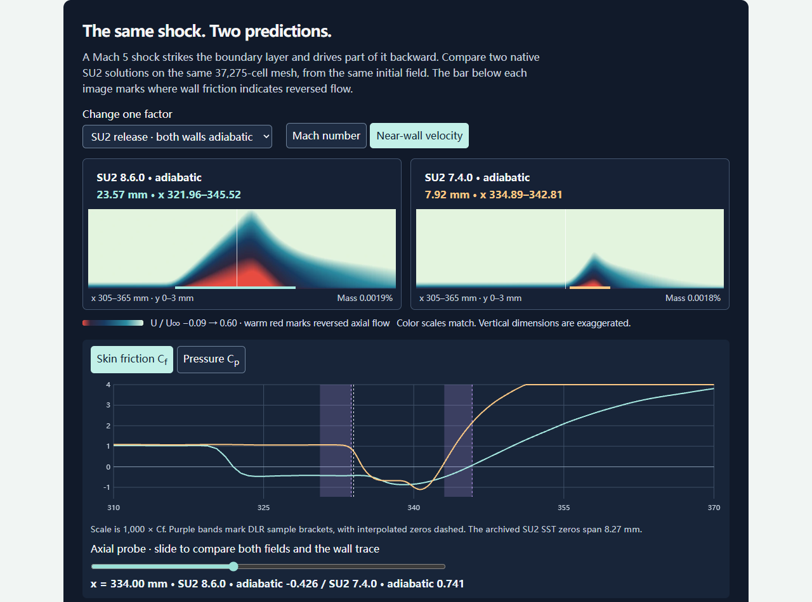

# MachAtlas

**See how the same Mach 5 shock can produce different predictions of reversed flow.**

[Which model fits the wind tunnel better?](https://hengyuhang61-creator.github.io/machatlas/ramp.html?x=10&discount=0#metric-lab) Change the cancellation credit, select one of ten stations and share the exact setting. Recompute the crossing weights with `node metric-sweep.mjs`.

**Mach 5 discrepancy study.** [Compare two native SU2 solutions](https://hengyuhang61-creator.github.io/machatlas/research.html#discrepancy), change a single factor, and inspect Mach number, near-wall velocity, wall friction and pressure. [Methods and native replay](research/DISCREPANCY.md).

**Solver version archive.** [SU2 wall heat flux in a conducting slab](research/heat-flux/README.md) measures the exported flux and analytic temperature slope before and after an upstream change.

On one mesh and initial state, SU2 8.6.0 predicts 23.57 mm of separation and SU2 7.4.0 predicts 7.92 mm. Changing just the strain input to the eddy-viscosity limiter in a matching v8.6.0 build reproduces the large decrease.

An interactive atlas of three wind-tunnel shock–boundary-layer interaction cases. Explore measured velocity maps and change the comparison metric or radial sampling band.

[Open the atlas](https://hengyuhang61-creator.github.io/machatlas/) · [Release](https://github.com/hengyuhang61-creator/machatlas/releases/latest) · [Report an issue](https://github.com/hengyuhang61-creator/machatlas/issues/new) · [中文](README.zh-CN.md)



| Case | What you can inspect |
| --- | --- |
| [Mach 2.05 ramp](https://hengyuhang61-creator.github.io/machatlas/ramp.html) | Stanford PIV and archived SU2. Change the error metric on identical samples. |
| [Mach 2.5 axisymmetric cone](https://hengyuhang61-creator.github.io/machatlas/cone.html) | NASA PIV and archived RANS. Move a 3 mm radial band to change the FUN3D model comparison. |
| [Mach 3 HMVE](https://hengyuhang61-creator.github.io/machatlas/hmve.html) | Compare measured band means at two nominal diameter Reynolds numbers across 21 matched stations. |

## Reproduce

Use Python 3.13, Git and Node.js 24. From this checkout, run the following commands in an isolated Python environment. The second checkout pins the analysis and data hashes. `fetch` downloads source data from their original hosts. `run` performs offline post-processing.

```sh
git clone https://github.com/hengyuhang61-creator/swbli-physics-bench.git
git -C swbli-physics-bench checkout d1f488778142859aff05bca5d766a7da4f9afa7d
python -m pip install -r swbli-physics-bench/requirements.txt
cd swbli-physics-bench
python -m analysis fetch all
python -m analysis run all
python -m unittest discover -s tests -v
cd ..
python make_data.py swbli-physics-bench/results/local/replay
python make_figures.py swbli-physics-bench
node --test checks.test.mjs
python -m http.server 8000 --directory site
```

Open http://localhost:8000. For a single-case replay, pass `m205`, `m25`, or `hmve` to both `fetch` and `run` in the bench checkout. Atlas tables require all three cases. To check a clean generated table against the released one, write it to a separate path with `make_data.py ... --out replayed.json` and set `ATLAS_REPLAY=replayed.json` before running the Node tests.

The three atlas cases use experimental PIV, with archived CFD comparison columns for Mach 2.05 and Mach 2.5. The commands above replay those archived comparisons. The research workflow also includes native SU2 execution and publishes the results of full study runs. CI builds the offline atlas, checks the native evidence and runs a separate 20-iteration SU2 smoke case. Full Mach 5 and Mach 2.05 study replay is opt-in. The evidence supports bounded numerical comparisons. Experimental validation remains open.

[Watch actual native-state inspection](media/native-study-demo.gif) · [Native launch material](PROMOTION_NATIVE.md) · [Original radial-window demo](media/demo.gif) · [Sources and rights](SOURCES.md) · [Launch copy](PROMOTION.md) · [MIT license](LICENSE)
