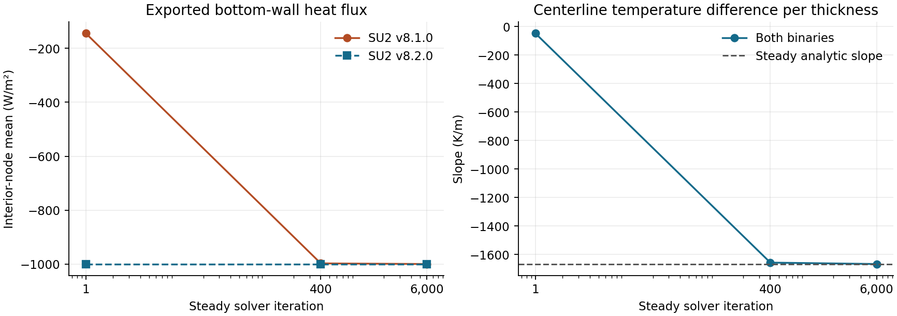

# SU2 wall heat flux in a conducting slab

For an initially uniform, stagnant slab with equal and opposite prescribed wall fluxes, SU2 v8.1.0 exported a bottom-wall interior mean of −144.24 W/m² at iteration 1. SU2 v8.2.0 exported −1,000 W/m². The saved temperature, zero velocity and temperature residual agreed at every matched checkpoint. Both reports approached −1,000 W/m² as the slab reached the steady analytic slope.



## Source trace and controls

[SU2 PR 2394](https://github.com/su2code/SU2/pull/2394) changed the non-NEMO heat-flux branch of CFVMFlowSolverBase::Friction_Forces. The old branch exported a reconstructed temperature gradient times conductivity. For a uniform HEAT_FLUX marker the revised branch exports the nominal marker flux with the output sign convention. The PR also changes isothermal geometry and wall treatment. The present run uses prescribed flux, no wall functions, and constant-density properties. Historical details and motivations are in [upstream issue 2347](https://github.com/su2code/SU2/issues/2347).

The geometry is a 10 mm square with zero velocity, density 1 kg/m³, heat capacity 100 J/(kg K), and conductivity 0.6 W/(m K). Initialize 300 K everywhere. The lower and upper markers receive +1,000 and −1,000 W/m² in the configuration. Vertical sides are adiabatic. The analytic steady slope is −1,666.6667 K/m. Pure Neumann boundaries leave the absolute temperature offset arbitrary, so the slope is the comparison quantity. On surfaces the bottom sign is negative, top positive. Corner entries can inherit either adjacent marker, so statistics use interior nodes of each edge. The default history maxHF is a norm of nodal fluxes. It is 1,502.70 and 1,630.69 on the two grids after the fix, while the individual prescribed flux magnitude is 1,000. Net history HF cancels oppositely signed walls.

| Grid and stopping point | v8.1 bottom mean W/m² | v8.2 bottom mean W/m² | Max saved absolute temperature difference K |
| --- | ---: | ---: | ---: |
| 12×12, 1 | −144.24186 | −1,000 | 0 |
| 12×12, 400 | −997.65274 | −1,000 | 0 |
| 12×12, 6,000 | −1,000 | −1,000 | 0 |
| 24×24, 1 | −144.37020 | −1,000 | 0 |
| 24×24, 6,000 | −1,000 | −1,000 | 0 |
| 12×12 adiabatic, 1 | 0 | 0 | 0 |

The old report also shows up to 14.686 W/m² spurious vertical-side magnitude in the coarse early checkpoint. The revised report returns zero there. The near-wall gradient reconstructed independently from the saved first-interval temperatures gives −144.488 W/m² at the coarse midspan. This supports the gradient mechanism at a fixed field and uses a simple difference on the output, while the native code uses its own gradient stencil. At 6,000 iterations the centerline slopes were −1,666.666666666 and −1,666.666666261 K/m. Identical grid and config hashes were checked for each pair. Full terminal data are in [results JSON](plate-results.json).

The official pre/post release packages use the same Windows target and one OpenMP thread here, with no local rebuild. Compiler and bundled library differences were not isolated. The identical saved fields and matched source branches limit the attribution to the tested output behavior. The two grids serve as a sensitivity control. The case does not establish grid uncertainty for general flows, the accuracy of heat-transfer predictions under other boundary types, or experimental validation. Early exact reported Neumann flux cannot certify the interior temperature, as the plot shows.

## Native replay

Use the non-MPI Windows archives in [v8.1.0](https://github.com/su2code/SU2/releases/tag/v8.1.0) and [v8.2.0](https://github.com/su2code/SU2/releases/tag/v8.2.0). The latter archive contains a nested win64.zip. Use Python 3.11 or later. Each call creates a fresh output directory with generated config, mesh, solver log and native restart/surface data.

```powershell
$old = 'C:\solver\su2-8.1\bin\SU2_CFD.exe'
$new = 'C:\solver\su2-8.2\bin\SU2_CFD.exe'
foreach ($tag in 'pre','post') {
    $exe = if ($tag -eq 'pre') { $old } else { $new }
    python run_plate.py $exe "runs/matrix-$tag-early" --n 12 --iterations 1
    python run_plate.py $exe "runs/matrix-$tag-mid" --n 12 --iterations 400
    python run_plate.py $exe "runs/matrix-$tag-tail" --n 12 --iterations 6000
    python run_plate.py $exe "runs/matrix-$tag-fine-early" --n 24 --iterations 1
    python run_plate.py $exe "runs/matrix-$tag-fine-tail" --n 24 --iterations 6000
    python run_plate.py $exe "runs/matrix-$tag-adiabatic" --n 12 --iterations 1 --heat 0
}
python analyze_plate.py runs
```

Windows archive SHA-256 v8.1.0 `1319279f7b9f95d9faebeefcea6368a5c96bbe7f72388579a62aa146da63e2b4`. v8.2.0 `1431c3230dac53d22f784126c35c6f3dbeacab5d02237cc39dbf8c386ae3befd`. Executable SHA-256 respectively `d53471ec1b00e5f81524331aca0031cd55a6a29e833a63bef41e74fc701bc16f` and `fdb623e2968e55e2b30ad2d5ec83dcb9e5c6b38e76fd73a739b11bb4aac0721c`. Binaries and upstream code remain available from SU2.

Other source changes with potential follow-up cases include [SU2 PR 2829](https://github.com/su2code/SU2/pull/2829) for viscous flux at supersonic outlets, [OpenFOAM Foundation 11](https://openfoam.org/release/11/) for anisotropic thermal boundary flux, and [OpenCFD v2606](https://www.openfoam.com/news/main-news/openfoam-v2606/solvers-and-physics) for solid inter-material flux. This archive has native evidence for the slab case.
